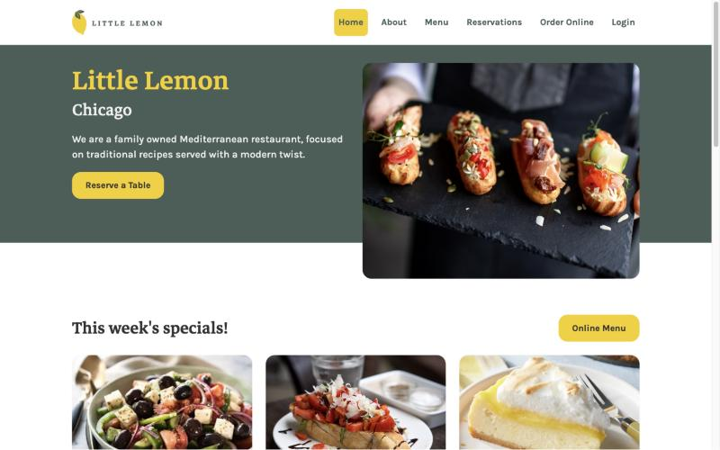
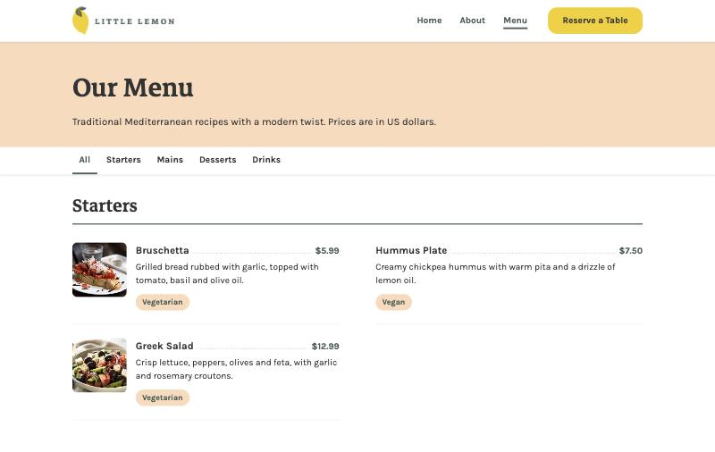
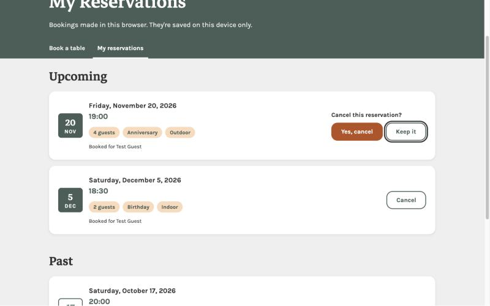
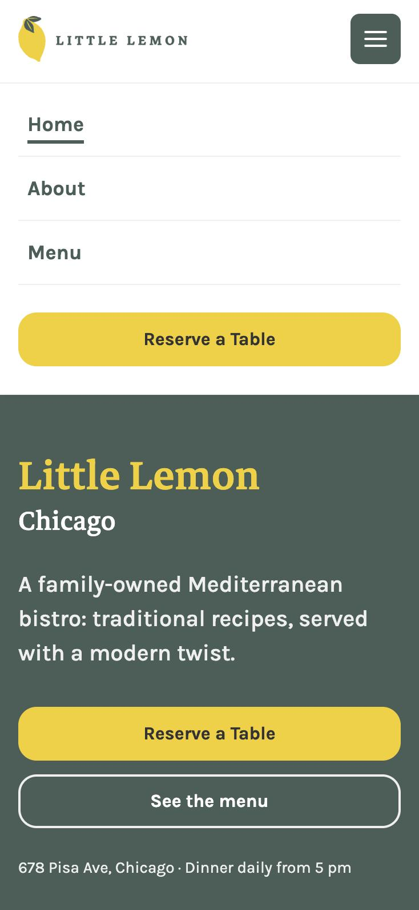
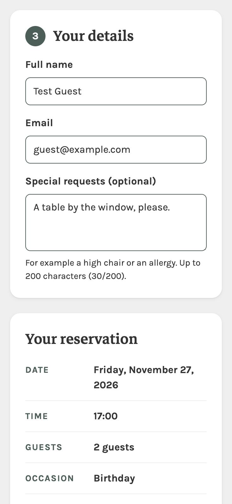
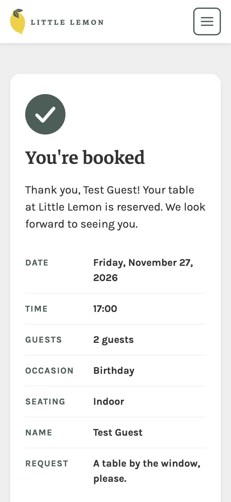

# Little Lemon: Reserve a Table

A React web app for a small restaurant where you can pick a date, time and party size, and book a table online.

**Live demo: [littlelemon-chicago.vercel.app](https://littlelemon-chicago.vercel.app)**

## About

This is my capstone project for the Meta Front-End Developer course.
It builds the website for Little Lemon, a fictional family-owned Mediterranean restaurant in Chicago that the course uses as its example business: a home page, a menu that loads its dishes and filters them, an About page, and a table booking flow.
The focus is a booking form that works, checks what you type, and is usable with a keyboard and a screen reader. Bookings are saved in the browser, so you can see and cancel them on a My Reservations page.

## Quick start

You need Node.js 20 or newer and Git.

```bash
git clone https://github.com/JNevier/little-lemon.git
cd little-lemon
npm install
npm test -- --watchAll=false
npm start
```

The app opens at [http://localhost:3000](http://localhost:3000). Step-by-step details are in [Getting started](#getting-started).

## For reviewers

| What to check | Where to find it |
| --- | --- |
| The live site | [littlelemon-chicago.vercel.app](https://littlelemon-chicago.vercel.app) |
| What it looks like | [Screenshots](#screenshots) |
| Speed and accessibility scores | [Lighthouse](#lighthouse) |
| Design and responsive layout | Open the app and resize the window, or see [Design](#design) |
| Booking form and validation | [Try the booking flow](#try-the-booking-flow) |
| Edge cases and error messages | [Try the edge cases](#try-the-edge-cases) |
| Unit tests | [Testing](#testing) |
| Accessibility and semantic HTML | [Accessibility](#accessibility) |
| Git history | [Git workflow](#git-workflow) |
| Code and comments | [Project structure](#project-structure) |

## Features

- **Home page** with a hero section, this week's specials, customer reviews and a short "about us" section.
- **Menu page** that loads the dishes from a JSON file, with filter buttons for Starters, Mains, Desserts and Drinks, a loading message and a clear error if the menu can't be loaded.
- **About page** with the restaurant's story and a link to book a table.
- **No dead links**: every link in the navigation opens a real page. Order Online and Login show a "coming soon" page.
- **Booking form** with date, time, number of guests, occasion, seating preference (indoor, outdoor or no preference), full name, email and optional special requests (up to 200 characters).
- **Available times change with the date** you pick.
- **Validation with clear messages**: you can't pick a past date, book for fewer than 1 or more than 10 guests, or leave out your name or a valid email. Name and email errors only appear after you leave the field, so a fresh form isn't covered in red. The submit button stays disabled until everything is valid, with a note under it saying why.
- **Confirmation page** that shows the booking's date, time and number of guests.
- **My Reservations page**: every booking is saved in the browser (`localStorage`), so it's still there after a reload. Each one can be cancelled, and screen readers announce "Reservation cancelled."
- **No double bookings**: a time you've already booked disappears from the time list for that date, and comes back if you cancel. (Demo rule: this browser can't book the same slot twice. With no real server, other visitors' bookings aren't known.)
- **Helpful messages for edge cases**: a failed save, a date with no times, a cleared date, and a visit to the confirmation page with no booking.
- **Responsive layout**: designed for phones first and checked from 280px (the smallest phones) to 1920px wide, in portrait and landscape. On phones the navigation folds into a menu button; from 768px up the links are always shown, and from 1024px they sit beside the logo. Nothing scrolls sideways, and every link and button is at least 44px tall, so it's easy to tap.
- **Accessible**: every field has a label, errors are read out by screen readers, and the whole flow works with the keyboard alone.

## Screenshots

All names, emails and bookings in these screenshots are fake test data.

**Desktop**







**Phone**

| Menu button opened | Booking form | Confirmation |
| --- | --- | --- |
|  |  |  |

## Lighthouse

Measured with [PageSpeed Insights](https://pagespeed.web.dev) (Lighthouse 13.6, **mobile**: an emulated mid-range phone on a slow 4G connection) on the live home page, November 8, 2026 (re-run after the hero photo change).

| Performance | Accessibility | Best Practices | SEO |
| --- | --- | --- | --- |
| 89 | 100 | 100 | 100 |

The first run scored 85 for Performance. The slow part was **Largest Contentful Paint**: the time until the biggest thing on screen, the hero photo, has loaded. Phones were downloading the full 288 KB photo. Now they get a smaller copy (133 KB, chosen by the browser with `srcset` and `sizes`), and the photo is marked `fetchpriority="high"` so it downloads first. That brought Largest Contentful Paint down from 4.2 s to 3.5 s and Performance up from 85 to 89.

First paint (1.5 s), blocking time (0 ms) and layout shift (0) are all in the green. What's left is mostly the time it takes to download and run the app's JavaScript on a slow phone before the photo can appear. Scores change a few points from run to run.

## Tech stack

- **React 19**: builds the user interface from components.
- **React Router 7**: moves between pages (home, menu, about, booking, confirmation, my reservations) without reloading.
- **Create React App** (`react-scripts` 5): runs, tests and builds the project with no extra setup.
- **Jest and React Testing Library**: unit tests that check the app the way a user sees it.
- **Plain CSS** with CSS variables for the brand colours and fonts.
- **Vercel** for hosting (see [Deployment](#deployment)).

No other libraries: no CSS framework, no form library and no state library. Forms, validation and shared state are written by hand with React's own hooks.

### React hooks used

| Hook | Where | What it does there |
| --- | --- | --- |
| `useState` | Booking form, menu filter, phone menu, My Reservations | Remembers a value between renders, like a field's text or which filter is chosen. |
| `useReducer` | `Main.js` | Works out the available times when the date changes (the course's `initializeTimes` and `updateTimes`). |
| `useEffect` | `useFetch`, `useLocalStorage`, `Header` | Runs code after the screen updates: loading the menu, saving bookings, closing the phone menu on a page change. |
| `useRef` | `Header`, My Reservations | A direct handle on an element, to move keyboard focus back to the menu button or to the heading. |
| `useContext` | `useReservations()` | Reads the saved reservations from any page without passing props down. |
| `useNavigate`, `useLocation` | `Main.js`, `ConfirmedBooking`, `Header` | React Router hooks: go to the confirmation page in code, and read the current page. |
| `useFetch` (custom) | Menu page | Loads JSON and returns `{ data, loading, error }`, and cancels the request if the page closes first. |
| `useLocalStorage` (custom) | Reservations context | Like `useState`, but the value is also saved in the browser. |
| `useReservations` (custom) | Main, My Reservations | Gives the saved reservations and the add and cancel functions. |

## Getting started

### Prerequisites

You need two things installed:

- **Node.js 20 or newer**, which also installs **npm**. Check yours with `node -v`. I built and tested this project with v24.5.0.
- **Git**, to download the project. Check yours with `git --version`.

The commands below work the same in macOS/Linux Terminal and in Windows PowerShell.

### Clone the repository

```bash
git clone https://github.com/JNevier/little-lemon.git
cd little-lemon
```

The first line downloads the project into a new folder called `little-lemon`. The second line moves you into that folder.
**Why:** every command after this one must be run inside the project folder, because that's where `package.json` is.

### Install the dependencies

```bash
npm install
```

This downloads the packages the project needs (React, React Router, the test tools) into a `node_modules` folder. It can take a minute.
**Why first:** the start, test and build commands use these packages, so they fail until this step has run.

You may see deprecation warnings during the install. That's normal for Create React App. Only worry if the install stops with an error.

### Start the app

```bash
npm start
```

This starts a local development server and opens the app in your browser at [http://localhost:3000](http://localhost:3000).
If port 3000 is already in use, it asks to use another port; press `Y` and use the address it prints.
Stop the server with `Ctrl + C`.

### Run the tests

```bash
npm test -- --watchAll=false
```

This runs every test once and shows the results.

You can also run `npm test` on its own. That starts **watch mode**: it waits and re-runs the tests when you change a file. On a fresh copy it may say "No tests found related to files changed since last commit". If you see that, press `a` to run all tests. Press `q` to quit watch mode.

### Build for production

```bash
npm run build
```

This makes an optimised version of the app, ready to put on a web server, in a new `build` folder.
You don't need it to try the app. `npm start` is enough.

## Deployment

The site is hosted on [Vercel](https://vercel.com) at **[littlelemon-chicago.vercel.app](https://littlelemon-chicago.vercel.app)**, connected to this GitHub repository. Every push to `main` deploys a new version.

| Vercel setting | Value |
| --- | --- |
| Framework preset | Create React App |
| Branch | `main` |
| Build command | `npm run build` |
| Output directory | `build` |

**Why there's a `vercel.json` file:** this is a single-page app. There's only one real page, `index.html`, and React Router draws the right screen for the address. Clicking a link works without it, but **reloading** `/menu` or opening a shared link to `/reservations` makes the server look for a file called `menu`, which doesn't exist, so it would show a 404 error. The rewrite in `vercel.json` tells Vercel: "for any address that isn't a real file, send `index.html`". Real files, like `/data/menu.json` and the images, are still served as they are.

## Try the booking flow

1. Run `npm start` and click **Reservations** in the menu, or **Reserve a Table** on the home page.
2. The date starts on today. Pick a later date with a different day of the month, and the list of times changes.
3. Type `0` in **Number of guests**. A message appears under the field, and the **Make Your reservation** button turns faded and can't be clicked.
4. Change it to a number from 1 to 10. The message goes away and the button works again.
5. Choose a time and an occasion. Type your name, then type an email like `a@b` and press `Tab`: an error appears. Fix the email and the error goes away. Pick a seating preference (the arrow keys move between the choices).
6. Click **Make Your reservation** (or press `Enter` in a text field).
7. You land on the **Booking Confirmed** page, which thanks you by name and shows your date, time, number of guests and seating.
8. Click **View my reservations**. Your booking is listed. Reload the page: it's still there.
9. Go back to **Reservations** and pick the same date. The time you booked is no longer in the list.
10. On **My Reservations**, click **Cancel**. The booking disappears, and its time is offered again on the booking form.

## Try the edge cases

1. **Visit the confirmation page with no booking.** Go to [http://localhost:3000/confirmed](http://localhost:3000/confirmed). It says you haven't made a booking yet and links to the booking page.
2. **Clear the date.** On the booking page, clear the date field. Only the date error shows, the time list shows **No times available**, and the button stays disabled.
3. **Try invalid guest numbers.** Type `0`, `11` or `2.5`. A message appears and the button stays disabled.

Two cases can't be triggered in the browser, because the course API always saves and always offers times for a real date. The automated tests cover them:

- **A failed save** shows "We couldn't save your booking. Please try again." and stays on the form.
- **A date with no times** shows "No times are available on this date. Please choose another date."

## Project structure

```text
src/
├── App.js
├── index.js
├── index.css
├── api.js
├── hooks/
│   ├── useFetch.js
│   └── useLocalStorage.js
├── context/
│   └── ReservationsContext.js
├── components/
│   ├── BookingForm/
│   ├── Main/
│   ├── MenuItem/
│   ├── Header/
│   ├── Nav/
│   ├── Footer/
│   └── ...
├── pages/
│   ├── HomePage/
│   ├── MenuPage/
│   ├── AboutPage/
│   ├── ComingSoonPage/
│   ├── BookingPage/
│   ├── ConfirmedBooking/
│   ├── MyReservationsPage/
│   └── NotFoundPage/
└── utils/
```

- `src/components/`: reusable pieces of the page. Each folder holds a component, its CSS and, where there is one, its test.
- `src/components/BookingForm/`: the booking form, its validation functions (`validation.js`) and their tests.
- `src/components/Main/`: the page routes and the booking logic (available times and submitting a booking).
- `src/pages/`: one folder per page the router can show.
- `src/hooks/`: custom hooks. `useFetch(url)` loads JSON and returns `{ data, loading, error }`, and cancels the request if the page closes first. `useLocalStorage(key, initialValue)` works like `useState` but also saves the value in the browser.
- `src/context/`: `ReservationsContext.js` shares the saved reservations with any page through `useReservations()`, so they don't have to be passed down through every component.
- `public/data/menu.json`: the sample menu. Files in `public/` are served as they are, so the app fetches it like a real API.
- `src/utils/`: small helpers. `dates.js` converts between a date input's `YYYY-MM-DD` text and a JavaScript date, and checks that a date is complete.
- `src/api.js`: the course's booking API (see [About the booking API](#about-the-booking-api)).
- `src/index.css`: the global styles and the brand colours and fonts as CSS variables.
- `vercel.json`: tells Vercel to send `index.html` for every page address (see [Deployment](#deployment)).

## Testing

Run the tests with `npm test -- --watchAll=false` (see [Run the tests](#run-the-tests)).

Each test file sits next to the code it tests and ends in `.test.js`. The tests cover:

- **The booking form**: the labels, the HTML validation attributes (`required`, `min`, `max`, `maxLength`), the `autocomplete` values, the button being disabled or enabled with its explanation, and that a valid booking is sent once with the right data while an invalid one is never sent.
- **Errors after "touched"**: name and email errors are hidden on a fresh form, appear after leaving the field with a bad value, and disappear once it's fixed.
- **The seating group**: found as a group named "Seating preference", one shared name for its radio buttons, and "No preference" picked first.
- **The validation functions**: valid and invalid values for each field, including the edges (for example 0, 1, 10 and 11 guests; an empty name, only spaces and one letter; `a@b` and other email typos).
- **The available-times logic** in `Main.js`, with the API replaced by a fake (a mock), so the results don't depend on today's date.
- **Accessibility details**: each field is found by its label, the form has a name, errors are linked to their fields, and the confirmation page moves focus to its heading.
- **Edge cases**: a failed save, a direct visit to the confirmation page, a date with no times, and a cleared date.
- **Loading data** (`useFetch`): a successful load, an HTTP error, a network error, and a cancelled request that must not show an error. `fetch` is replaced by a fake in each test.
- **The menu page**: the loading message, the dishes and their prices, the category filter and its pressed state, and the error message.
- **Routing**: every in-app link on the home page and in the nav opens a real page, and an unknown address shows the 404 page.
- **The phone menu**: the button opens and closes the menu, `Escape` closes it and returns focus to the button, and moving to another page closes it.
- **Saving in the browser** (`useLocalStorage`): reading, writing, broken saved data and blocked storage, none of which may crash the app. Each test starts with `localStorage.clear()`.
- **Reservations** (Context and My Reservations page): adding, cancelling, sorting by date and time, the empty state, the "Reservation cancelled." message, and that booked times are hidden on the form.
- **The whole booking journey** in one test: book a table, reload, see it on My Reservations, check its time is hidden, cancel it, and check the time is back.

- **Navigation and page titles**: the nav has all six links in order and marks only the current page with `aria-current="page"`; the skip link is the first Tab stop and moves focus to the main content; every page has its own browser tab title.

**Why fake the API and fix the date in tests:** a test that uses today's real date could pass today and fail tomorrow.

### Coverage

**87 tests in 14 files, all passing.** Coverage measured with `CI=true npm test -- --coverage --watchAll=false`:

| Statements | Branches | Functions | Lines |
| --- | --- | --- | --- |
| 98.62% | 91.05% | 98.92% | 98.57% |

What isn't covered: `src/index.js` (it only starts the app in a real browser), the course API's `submitAPI` (always replaced by a fake in tests), and a few branches in the booking form, the header and the menu page that only change an `aria-*` attribute or a fallback value.

## Accessibility

- **Labels**: every field has a `<label>` connected to it, so clicking the label focuses the field and screen readers read the label out.
- **Error messages**: an invalid field is marked with `aria-invalid` and linked to its message with `aria-describedby`, so a screen reader reads the problem when you reach the field.
- **Required fields**: marked with a visible `*` (and a "Fields marked * are required." note). The star is added by CSS and hidden from screen readers, which already announce "required" from the `required` attribute.
- **Grouped choices**: the seating radio buttons sit in a `<fieldset>` with a `<legend>`, so screen readers announce the group's name.
- **Autofill**: the name and email fields use `autocomplete="name"` and `autocomplete="email"` (WCAG 1.3.5), so browsers can fill them in.
- **Named form**: the form has the name "Reserve a Table", so screen-reader users can jump straight to it.
- **Button name**: the submit button's accessible name matches its visible text. **Why:** voice-control users say what they see ("click Make Your reservation"), so the names must match.
- **Skip link**: the first `Tab` on any page shows a "Skip to main content" link. Pressing `Enter` moves focus past the logo and the six nav links to the page content (WCAG 2.4.1).
- **Page titles**: every page sets its own browser tab title, like "Menu | Little Lemon", so you know where you are from the tab or a screen reader (WCAG 2.4.2).
- **Page changes**: the confirmation page also moves focus to its heading, so screen readers announce the new page.
- **Urgent messages**: the failed-save message uses `role="alert"`, so screen readers read it out as soon as it appears.
- **Menu filters**: the filter buttons use `aria-pressed`, so screen readers say which category is chosen. The loading message uses `role="status"` (read out politely) and a failed load uses `role="alert"`.
- **Cancel buttons**: every row's button says "Cancel", but its full name says which booking it cancels (for example "Cancel reservation for Friday, October 9, 2026 at 18:00"). After a cancel, focus moves to the page heading, so keyboard users don't lose their place.
- **Phone menu button**: it says whether the menu is open (`aria-expanded`), names the menu it controls (`aria-controls`), closes with `Escape` (focus goes back to the button) and closes when you move to another page.
- **Keyboard**: everything works with `Tab`, the arrow keys and `Enter`, and every control shows a visible focus ring.
- **Semantic HTML**: one `<h1>` per page, headings in order, and the `header`, `nav`, `main` and `footer` landmarks.

## About the booking API

The course provides a small booking API with two functions. A copy of it lives in [src/api.js](src/api.js):

- `fetchAPI(date)` returns the available times for a date, between 17:00 and 23:30. The times depend only on the **day of the month**, so the 9th of any month always shows the same times.
- `submitAPI(formData)` pretends to save a booking and always returns `true`.

Both are plain functions that answer straight away. There is no real server or network call.

**Why a local copy instead of loading it with a `<script>` tag:**

1. The course file is hosted on `raw.githubusercontent.com`, which sends it as plain text with a "don't guess the type" header (`nosniff`). Browsers refuse to run it as a script, so the functions would never exist.
2. Loading code live from someone else's repository means any later change to that file would run inside this app. A copy that I read and checked first is safer, and the tests can import it.

The only change from the original is that the two functions are exported. The top of the file records where it came from and when it was reviewed.

## Design

There is no Figma wireframe. I skipped that step and built the pages from the course's Little Lemon style guide (colours, fonts and spacing) and its mock-up.

## Known limitations

- **Coming-soon pages**: Order Online and Login aren't built. Their links open a "coming soon" page instead.
- **Sample data**: the menu, the About page story, the customer reviews and the contact details in the footer are made up.
- **Bookings stay in this browser**: the course API doesn't save anything, so bookings are kept in this browser's `localStorage` only. Another browser or device won't see them, and clearing site data removes them. The course API still always says a booking "succeeded".
- **Create React App is deprecated**: the React team stopped recommending Create React App in February 2025, and it no longer has active maintainers. It still builds and tests this project fine. Moving to [Vite](https://vite.dev) is a possible next step.
- **Demo-only double-booking check**: a booked time is hidden only in the browser that booked it. A real restaurant would need a server that knows every guest's bookings.

## Git workflow

- Every feature or fix was built on its own branch (for example `feat/booking-form`).
- Commit messages follow [Conventional Commits](https://www.conventionalcommits.org/), for example `feat(booking): add booking form with controlled fields`.
- Each branch was merged into `main` through a pull request on GitHub, with a short description of what changed and why.

## Author

[Reiven (JNevier)](https://github.com/JNevier)
