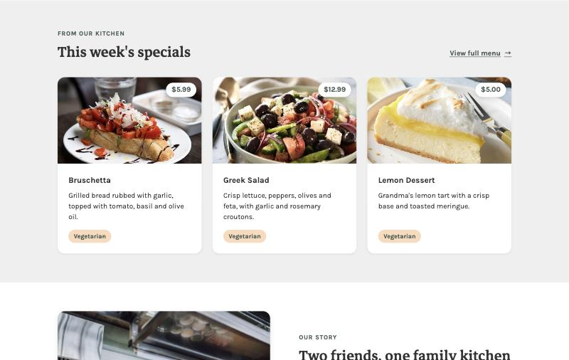
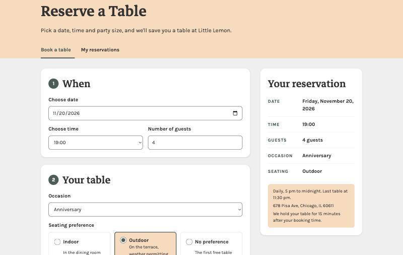
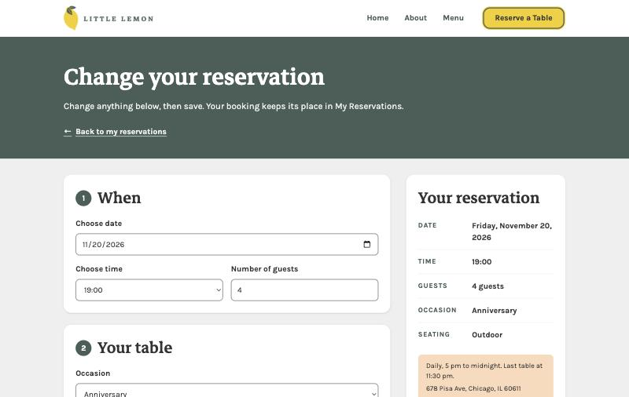
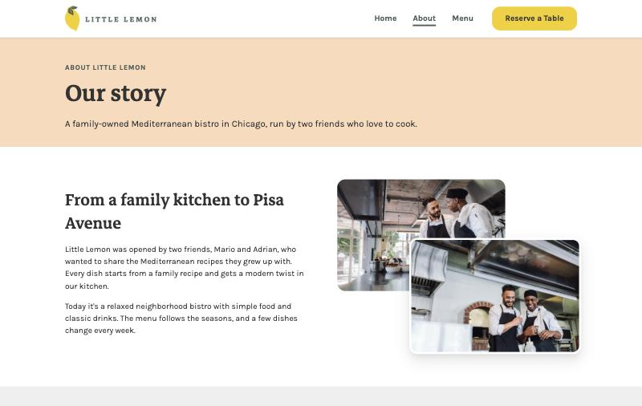

# Little Lemon: Reserve a Table

A React web app for a small restaurant where you can pick a date, time and party size, and book a table online.

**Live demo: [littlelemon-chicago.vercel.app](https://littlelemon-chicago.vercel.app)**

## About

This is my capstone project for the Meta Front-End Developer course.
It builds the website for Little Lemon, a fictional family-owned Mediterranean restaurant in Chicago that the course uses as its example business: a home page, a menu that loads its dishes and filters them, an About page, and a table booking flow.
The focus is a booking form that works, checks what you type, and is usable with a keyboard and a screen reader. Bookings are saved in the browser, so you can see and cancel them on a My Reservations page.

## Quick start

You need Node.js 20 or newer and Git.

```bash
git clone https://github.com/JNevier/little-lemon.git
cd little-lemon
npm install
npm test -- --watchAll=false
npm start
```

The app opens at [http://localhost:3000](http://localhost:3000). Step-by-step details are in [Getting started](#getting-started).

## For reviewers

| What to check | Where to find it |
| --- | --- |
| The live site | [littlelemon-chicago.vercel.app](https://littlelemon-chicago.vercel.app) |
| What it looks like | [Screenshots](#screenshots) |
| Speed and accessibility scores | [Lighthouse](#lighthouse) |
| Design and responsive layout | Open the app and resize the window, or see [Design](#design) |
| Booking form and validation | [Try the booking flow](#try-the-booking-flow) |
| Edge cases and error messages | [Try the edge cases](#try-the-edge-cases) |
| Unit tests | [Testing](#testing) |
| Accessibility and semantic HTML | [Accessibility](#accessibility) |
| Git history | [Git workflow](#git-workflow) |
| Code and comments | [Project structure](#project-structure) |
| Where the photos, fonts and code come from | [Credits](#credits) |

## Features

- **Home page** with a hero (a "Reserve a Table" button, a "See the menu" button and the address and opening time), three reasons to visit ("Why Little Lemon"), this week's specials as photo cards, a short story about the owners, and a "Visit us" section with the address, hours and phone number. The specials come from the same `menu.json` file as the Menu page, so a dish's name, price and description are the same everywhere. Grey placeholder cards keep their space while they load, so the page doesn't jump.
- **Menu page** that loads 13 dishes from a JSON file and lays them out like a printed menu: name, a dotted line, the price, a short description and dietary tags (Vegetarian, Vegan, Gluten-free, Contains nuts), with a photo for dishes that have one. "All" shows one section per category. The filter tabs stay at the top of the screen while you scroll, and the chosen filter is saved in the address (`/menu?category=Mains`), so the Back button and shared links work. Grey placeholder rows show while it loads, and if it can't load, a **Try again** button loads it again. The page ends with a "Reserve a Table" button.
- **About page**: "Our story" with two overlapping photos of the owners, three values ("What we believe", different from the home page's points), short bios of Mario and Adrian, and a green "Come hungry" panel with a Reserve button.
- **404 page** in the same style, with links back home, to the menu and to the booking form.
- **No dead links**: every link opens a real page. There is no online ordering or login: with no server, both would be fake, so the site leaves them out. An old link to `/order-online` or `/login` shows the "Page not found" page.
- **Booking form** in three numbered steps: **When** (date, time, number of guests), **Your table** (occasion, and seating as three choice cards: indoor, outdoor or no preference) and **Your details** (full name, email and optional special requests, up to 200 characters). Tabs at the top switch between **Book a table** and **My reservations**.
- **Live summary**: a "Your reservation" card shows the date, time, guests, occasion and seating as you fill in the form, with the opening hours, the address and the 15-minute hold. On wide screens it sits in a column on the right and stays in view while you scroll; on phones it sits just above the button.
- **Available times change with the date** you pick, and always match the date the form shows (also after **Book another table**, or after visiting another page and coming back). For today, times that have already passed are not offered.
- **Occasion**: "No special occasion" (the default), Birthday or Anniversary. Only a real occasion is shown on the summary and on My Reservations.
- **Validation with clear messages**: you can't pick a past date or one more than 90 days ahead ("We take bookings up to 90 days ahead."), book for fewer than 1 or more than 10 guests, or leave out your name or a valid email. Name and email errors only appear after you leave the field (or press the button), so a fresh form isn't covered in red. The **Confirm reservation** button is always enabled: pressing it with a problem shows an error summary at the top that lists each problem, links to its field, and gets keyboard focus. Only the optional field is marked "(optional)"; every other field is required.
- **Confirmation page**: a check mark, "You're booked", the same summary as beside the form, and two next steps: **View my reservations** and **Book another table**.
- **My Reservations page**: every booking is saved in the browser (`localStorage`), so it's still there after a reload. Bookings are split into **Upcoming** and **Past**, each card with a date badge, the time, small pills for guests, occasion and seating, and the name. **Cancel** asks first ("Cancel this reservation?" **Yes, cancel** / **Keep it**), and screen readers announce "Reservation cancelled." Past bookings are kept as a record and can't be cancelled or changed.
- **Change a reservation**: each upcoming booking has a **Change** link. It opens the same three-step form at `/reservations/<id>/edit`, filled in with that booking, with a **Save changes** button. Saving updates the same booking (same id) and shows **Reservation updated**. The booking's own time stays available while you change it. An unknown or past booking shows a short message with a link back, never a blank page.
- **No double bookings**: a time you've already booked disappears from the time list for that date, and comes back if you cancel. (Demo rule: this browser can't book the same slot twice. With no real server, other visitors' bookings aren't known.)
- **Never a blank page**: saved entries that aren't real bookings (for example `null`) are skipped, and if a page ever throws an error while drawing, an error boundary shows "Something went wrong" with **Reload** and **Back to the home page**, while the header and footer stay.
- **Two tabs stay in sync**: a booking made in one tab is picked up by the site's other open tabs (the browser's `storage` event), so a second tab can't overwrite it.
- **Helpful messages for edge cases**: a failed save, a date with no times, a cleared date, and a visit to the confirmation page with no booking.
- **Responsive layout**: designed for phones first and checked from 280px (the smallest phones) to 1920px wide, in portrait and landscape. On phones the navigation folds into a menu button; from 768px up the logo, the links and the Reserve a Table button share one row. Nothing scrolls sideways, and every link and button is at least 44px tall, so it's easy to tap (the footer's phone and email links are smaller only when the pointer is a mouse). On the narrowest phones (under 320px) the menu's filter tabs scroll sideways inside their own bar.
- **Accessible**: every field has a label, errors are read out by screen readers, and the whole flow works with the keyboard alone.

## Screenshots

All names, emails and bookings in these screenshots are fake test data.

**Desktop**












**Phone**

| Menu button opened | Booking form | Confirmation |
| --- | --- | --- |
|  |  |  |

## Lighthouse

Measured with [PageSpeed Insights](https://pagespeed.web.dev) (Lighthouse 13.6, **mobile**: an emulated Moto G Power on a slow 4G connection) on the live home page, **November 9, 2026, after the fix sprint** (changing a reservation, the booking rules, the error boundary and smaller menu images).

| Performance | Accessibility | Best Practices | SEO |
| --- | --- | --- | --- |
| 90 | 100 | 100 | 100 |

| First Contentful Paint | Largest Contentful Paint | Total Blocking Time | Cumulative Layout Shift | Speed Index |
| --- | --- | --- | --- | --- |
| 1.5 s | 3.4 s | 0 ms | 0 | 4.1 s |

Earlier runs on the live home page:

| Date | After | Performance | Accessibility | Best Practices | SEO | Largest Contentful Paint | Speed Index |
| --- | --- | --- | --- | --- | --- | --- | --- |
| November 8, 2026 | Smaller hero photos | 91 | 100 | 100 | 100 | 3.5 s | 1.5 s |
| November 9, 2026 | UI redesign | 91 | 100 | 100 | 100 | 3.4 s | 1.5 s |
| November 9, 2026 | Fix sprint | 90 | 100 | 100 | 100 | 3.4 s | 4.1 s |

Accessibility, Best Practices and SEO have stayed at 100, and Performance at 90 or above. On the home page the fix sprint only made the header logo smaller (the other smaller images are on the Menu page), so the higher Speed Index in this run is most likely the normal variation between Lighthouse runs on a slow, throttled connection. It will be checked again in a later run.

**How the hero photo was sped up** (before the redesign): the first run scored 85 for Performance. The slow part was **Largest Contentful Paint**: the time until the biggest thing on screen, the hero photo, has loaded. Phones were downloading the full 288 KB photo. Now they get a smaller copy (133 KB, chosen by the browser with `srcset` and `sizes`), and the photo is marked `fetchpriority="high"` so it downloads first. That brought Largest Contentful Paint down from 4.2 s to 3.5 s, and Performance up from 85 to 91.

Largest Contentful Paint (3.4 s) and, in the latest run, Speed Index (4.1 s) are the metrics not in the green yet. What's left is mostly the time it takes to download and run the app's JavaScript on a slow phone before the photo can appear. Scores change a few points from run to run.

## Tech stack

- **React 19**: builds the user interface from components.
- **React Router 7**: moves between pages (home, menu, about, booking, change a booking, confirmation, my reservations) without reloading.
- **Create React App** (`react-scripts` 5): runs, tests and builds the project with no extra setup.
- **Jest and React Testing Library**: unit tests that check the app the way a user sees it.
- **Plain CSS** with CSS variables for the brand colours and fonts.
- **Vercel** for hosting (see [Deployment](#deployment)).

No other libraries: no CSS framework, no form library and no state library. Forms, validation and shared state are written by hand with React's own hooks.

### React hooks used

| Hook | Where | What it does there |
| --- | --- | --- |
| `useState` | Booking form, phone menu, My Reservations | Remembers a value between renders, like a field's text or which filter is chosen. |
| `useReducer` | `Main.js` | Works out the available times when the date changes (the course's `initializeTimes` and `updateTimes`). |
| `useEffect` | `useFetch`, `useLocalStorage`, `Header`, booking form, My Reservations | Runs code after the screen updates: loading the menu, saving bookings, closing the phone menu on a page change, and moving focus to something that has just appeared (the error summary, the "Keep it" button). |
| `useRef` | `Header`, booking form, My Reservations, Menu page | A direct handle on an element, to move keyboard focus (to the menu button, the error summary or a heading), or to scroll the menu list back into view. |
| `useContext` | `useReservations()` | Reads the saved reservations from any page without passing props down. |
| `useNavigate`, `useLocation` | `Main.js`, `ConfirmedBooking`, `Header` | React Router hooks: go to the confirmation page in code, and read the current page. |
| `useParams` | Change page | Reads the booking's id from the address `/reservations/<id>/edit`. |
| `useSearchParams` | Menu page | Reads and writes `?category=` in the address, so the chosen filter survives Back, reload and shared links. |
| `useFetch` (custom) | Menu page, home page specials | Loads JSON and returns `{ data, loading, error, retry }`, and cancels the request if the page closes first. `retry()` loads it again. |
| `useLocalStorage` (custom) | Reservations context | Like `useState`, but the value is also saved in the browser. |
| `useReservations` (custom) | Main, My Reservations | Gives the saved reservations and the add and cancel functions. |

## Getting started

### Prerequisites

You need two things installed:

- **Node.js 20 or newer**, which also installs **npm**. Check yours with `node -v`. I built and tested this project with v24.5.0.
- **Git**, to download the project. Check yours with `git --version`.

The commands below work the same in macOS/Linux Terminal and in Windows PowerShell.

### Clone the repository

```bash
git clone https://github.com/JNevier/little-lemon.git
cd little-lemon
```

The first line downloads the project into a new folder called `little-lemon`. The second line moves you into that folder.
**Why:** every command after this one must be run inside the project folder, because that's where `package.json` is.

### Install the dependencies

```bash
npm install
```

This downloads the packages the project needs (React, React Router, the test tools) into a `node_modules` folder. It can take a minute.
**Why first:** the start, test and build commands use these packages, so they fail until this step has run.

You may see deprecation warnings during the install. That's normal for Create React App. Only worry if the install stops with an error.

### Start the app

```bash
npm start
```

This starts a local development server and opens the app in your browser at [http://localhost:3000](http://localhost:3000).
If port 3000 is already in use, it asks to use another port; press `Y` and use the address it prints.
Stop the server with `Ctrl + C`.

### Run the tests

```bash
npm test -- --watchAll=false
```

This runs every test once and shows the results.

You can also run `npm test` on its own. That starts **watch mode**: it waits and re-runs the tests when you change a file. On a fresh copy it may say "No tests found related to files changed since last commit". If you see that, press `a` to run all tests. Press `q` to quit watch mode.

### Build for production

```bash
npm run build
```

This makes an optimised version of the app, ready to put on a web server, in a new `build` folder.
You don't need it to try the app. `npm start` is enough.

## Deployment

The site is hosted on [Vercel](https://vercel.com) at **[littlelemon-chicago.vercel.app](https://littlelemon-chicago.vercel.app)**, connected to this GitHub repository. Every push to `main` deploys a new version.

| Vercel setting | Value |
| --- | --- |
| Framework preset | Create React App |
| Branch | `main` |
| Build command | `npm run build` |
| Output directory | `build` |

**Why there's a `vercel.json` file:** this is a single-page app. There's only one real page, `index.html`, and React Router draws the right screen for the address. Clicking a link works without it, but **reloading** `/menu` or opening a shared link to `/reservations` makes the server look for a file called `menu`, which doesn't exist, so it would show a 404 error. The rewrite in `vercel.json` tells Vercel: "for any address that isn't a real file, send `index.html`". Real files, like `/data/menu.json` and the images, are still served as they are.

## Try the booking flow

1. Run `npm start` and click the yellow **Reserve a Table** button in the header or on the home page.
2. The date starts on today. Pick a later date with a different day of the month, and the list of times changes.
3. Type `0` in **Number of guests**. A message appears under the field, and the summary on the right says "Not chosen yet" for guests.
4. Change it to a number from 1 to 10. The message goes away and the summary updates.
5. Choose a time and an occasion (it starts on "No special occasion"). Type your name, then type an email like `a@b` and press `Tab`: an error appears. Fix the email and the error goes away. Pick a seating preference (the arrow keys move between the choices).
6. Click **Confirm reservation** (or press `Enter` in a text field). If something is missing, a box at the top lists it; click a problem to jump to its field.
7. You land on the **You're booked** page, which thanks you by name and shows your date, time, number of guests, occasion and seating.
8. Click **View my reservations**. Your booking is listed. Reload the page: it's still there.
9. Click the **Book a table** tab and pick the same date. The time you booked is no longer in the list.
10. On **My Reservations**, click **Change**, pick another time and click **Save changes**. You see **Reservation updated**, and the card shows the new time.
11. Click **Cancel**, then **Yes, cancel**. The booking disappears, and its time is offered again on the booking form. (**Keep it** leaves the booking as it was.)

## Try the edge cases

1. **Visit the confirmation page with no booking.** Go to [http://localhost:3000/confirmed](http://localhost:3000/confirmed). It says you haven't made a booking yet and links to the booking page.
2. **Clear the date.** On the booking page, clear the date field. Only the date error shows, and the time list shows **No times available**. Pressing **Confirm reservation** lists the problem in the error summary.
3. **Try invalid guest numbers.** Type `0`, `11` or `2.5`. A message appears under the field, and pressing **Confirm reservation** lists it in the error summary instead of sending the booking.
4. **Press Confirm on an empty form.** The error summary says "Please fix 2 problems" (name and email), gets focus, and each item jumps to its field.

Two cases can't be triggered in the browser, because the course API always saves and always offers times for a real date. The automated tests cover them:

- **A failed save** shows "We couldn't save your booking. Please try again." and stays on the form.
- **A date with no times** shows "No times are available on this date. Please choose another date."

## Project structure

```text
src/
├── App.js
├── index.js
├── index.css
├── api.js
├── hooks/
│   ├── useFetch.js
│   └── useLocalStorage.js
├── context/
│   └── ReservationsContext.js
├── data/
│   └── restaurant.js
├── components/
│   ├── BookingForm/
│   ├── Main/
│   ├── MenuItem/
│   ├── Header/
│   ├── Nav/
│   ├── Footer/
│   └── ...
├── pages/
│   ├── HomePage/
│   ├── MenuPage/
│   ├── AboutPage/
│   ├── BookingPage/
│   ├── ConfirmedBooking/
│   ├── MyReservationsPage/
│   ├── EditReservationPage/
│   └── NotFoundPage/
└── utils/
```

- `src/components/`: reusable pieces of the page. Each folder holds a component, its CSS and, where there is one, its test.
- `src/components/BookingForm/`: the booking form, its validation functions (`validation.js`) and their tests.
- `src/components/ReservationSummary/`: the booking details as label/value pairs, shared by the booking form's live summary and the confirmation page. `src/components/ReservationTabs/`: the "Book a table" / "My reservations" tabs.
- `src/components/FeatureList/`: a row of points with an icon, a title and a sentence, used by "Why Little Lemon" on the home page and "What we believe" on About. `src/components/Icons/`: the small inline-SVG line icons (no icon library).
- `src/components/Main/`: the page routes (`/`, `/menu`, `/about`, `/reservations`, `/reservations/:id/edit`, `/confirmed`, `/my-reservations`, and a 404 for anything else) and the booking logic (available times, and submitting or changing a booking).
- `src/components/ErrorBoundary/`: the safety net around the pages that shows "Something went wrong" instead of a blank page.
- `src/pages/`: one folder per page the router can show. `EditReservationPage` reuses the booking form to change a saved booking.
- `src/hooks/`: custom hooks. `useFetch(url)` loads JSON and returns `{ data, loading, error, retry }`, cancels the request if the page closes first, and loads again when `retry()` is called. `useLocalStorage(key, initialValue)` works like `useState` but also saves the value in the browser, and picks up changes that other open tabs save.
- `src/context/`: `ReservationsContext.js` shares the saved reservations with any page through `useReservations()`, so they don't have to be passed down through every component.
- `public/images/`: the photos and logos. The dish photos are resized with macOS `sips` (for example `bruschetta.jpg` went from a 1920px, 404 KB PNG to an 800px, 76 KB JPEG, and `shakshuka.jpg` from 313 KB to 75 KB), so they load quickly on phones. Every dish on the menu has a photo. The new dish photos are at most 640px on their longer side, and each one is 30–90 KB. The menu shows each photo only 96px wide, so every dish also has a 200×200 copy (`<name>-200.jpg`, 11–22 KB) that the menu loads instead, with the full photo kept for very sharp screens (`srcSet` and `sizes`). The Menu page's photos went from about 800 KB to about 220 KB. The header uses a 360px-wide copy of the logo (19 KB instead of the 2000px, 45 KB original).
- `public/data/menu.json`: the sample menu. Files in `public/` are served as they are, so the app fetches it like a real API. Each dish has a name, category, price, description and dietary `tags`; dishes with `"featured": true` (and an `image`) appear in the home page's specials.
- `src/data/restaurant.js`: the restaurant's sample address, hours, phone number and email, in one place. The home page and the footer both read it, so they can't disagree.
- `src/utils/`: small helpers. `dates.js` converts between a date input's `YYYY-MM-DD` text and a JavaScript date, and checks that a date is complete. `price.js` formats a price as US dollars (`5` becomes `$5.00`), for the menu and the home page.
- `src/api.js`: the course's booking API (see [About the booking API](#about-the-booking-api)).
- `src/index.css`: the design system: brand colours, spacing, type sizes, shadows, buttons and the section layout, as CSS variables and shared classes.
- `scripts/check-contrast.js`: checks the colour contrast of every pair the site uses (see [Colour contrast](#colour-contrast)).
- `vercel.json`: tells Vercel to send `index.html` for every page address (see [Deployment](#deployment)).

## Testing

Run the tests with `npm test -- --watchAll=false` (see [Run the tests](#run-the-tests)).

Each test file sits next to the code it tests and ends in `.test.js`. The tests cover:

- **The booking form**: the labels, the HTML validation attributes (`required`, `min`, `max`, `maxLength`), `noValidate`, the `autocomplete` values, the three step headings, the always-enabled button, and that a valid booking is sent once with the right data while an invalid one is never sent.
- **The error summary**: it appears only after a submit with problems, lists each one as a link to its field, takes focus, shows the name and email errors even if those fields were never left, shrinks as problems are fixed, and disappears when none are left.
- **The live summary**: it shows the starting values, updates when the time, guests and seating change, and shows "Not chosen yet" for a wrong value.
- **Errors after "touched"**: name and email errors are hidden on a fresh form, appear after leaving the field with a bad value, and disappear once it's fixed.
- **The seating group**: found as a group named "Seating preference", one shared name for its radio buttons, "No preference" picked first, and a short description for each choice. Only the optional field says "(optional)", and there are no stars.
- **The validation functions**: valid and invalid values for each field, including the edges (for example 0, 1, 10 and 11 guests; an empty name, only spaces and one letter; `a@b` and other email typos).
- **The available-times logic** in `Main.js`, with the API replaced by a fake (a mock), so the results don't depend on today's date.
- **Accessibility details**: each field is found by its label, the form has a name, errors are linked to their fields, and the confirmation page moves focus to its heading and offers **View my reservations** (primary) and **Book another table** (secondary).
- **Edge cases**: a failed save, a direct visit to the confirmation page, a date with no times, and a cleared date.
- **Booking rules**: the form asks for the times of its own date whenever it appears (also after **Book another table** or a visit to another page); times that have passed today are hidden and checked again at submit (tested with a fixed clock, `jest.useFakeTimers()`); "No special occasion" is the default; the 90th day is accepted and the 91st is not.
- **Changing a booking**: the form starts from a saved booking, the booking's own time stays available while other bookings' times are hidden, saving keeps the same id, a failed save keeps the old booking, unknown and past bookings show a message, and the confirmation says "Reservation updated".
- **Resilience**: saved entries that aren't real bookings (`[null]`) are skipped without blanking a page, the error boundary shows its fallback and recovers on the next page, and a booking saved in another tab (a `StorageEvent`) is kept.
- **Loading data** (`useFetch`): a successful load, an HTTP error, a network error, a cancelled request that must not show an error, and `retry()` loading again after an error. `fetch` is replaced by a fake in each test.
- **The home page**: each section and its heading, the hero's two buttons, no invented reviews or star ratings, the loading skeleton, only the featured dishes with their photo, price and tags, a calm message with a menu link if the dishes can't load, and the Visit us details.
- **The menu page**: the loading skeleton, the dishes and their prices, one section per category under "All", the filter's pressed state, the filter in the address (`?category=`), opening a shared link on a filter, an unknown category falling back to "All", tags and photos, the error message, **Try again** (and where focus goes), and the closing Reserve button.
- **Routing**: every in-app link on the home page and in the nav opens a real page, and an unknown address shows the 404 page.
- **The About page**: its sections in order, no repeated "Little Lemon / Chicago" block, both owner photos with descriptions, three values that differ from the home page's, both owners with their roles, and the closing Reserve button.
- **The 404 page**: its heading and tab title, and links to Home (the main button), the menu and the booking form.
- **The phone menu**: the button opens and closes the menu, `Escape` closes it and returns focus to the button, and moving to another page closes it.
- **Saving in the browser** (`useLocalStorage`): reading, writing, broken saved data and blocked storage, none of which may crash the app, and picking up changes saved in another tab. Each test starts with `localStorage.clear()`.
- **Reservations** (Context and My Reservations page): adding, cancelling, sorting by date and time, Upcoming and Past (most recent past first, no Cancel on past ones), the empty states, the tabs with `aria-current`, Cancel asking first, **Keep it** returning focus to Cancel, **Yes, cancel** with the "Reservation cancelled." message, and that booked times are hidden on the form.
- **The whole booking journey** in one test: book a table, reload, see it on My Reservations, check its time is hidden, switch with the tab, cancel it (and confirm), and check the time is back.

- **Navigation and page titles**: the nav has its three page links and the yellow "Reserve a Table" button in order, and marks only the current page with `aria-current="page"`; the footer has one row of links, the opening hours and contact details, and no links to generic social sites; the skip link is the first Tab stop and moves focus to the main content; every page has its own browser tab title.

**Why fake the API and fix the date in tests:** a test that uses today's real date could pass today and fail tomorrow.

### Coverage

**173 tests in 21 files, all passing.** Coverage measured with `CI=true npm test -- --coverage --watchAll=false`:

| Statements | Branches | Functions | Lines |
| --- | --- | --- | --- |
| 98.63% | 95.68% | 98.75% | 98.57% |

What isn't covered: `src/index.js` (it only starts the app in a real browser), the course API's `submitAPI` (always replaced by a fake in tests), a few branches in the booking form and the header that only change an `aria-*` attribute or a fallback value, the menu page's scroll back to the top of the list, and the error page's **Reload** button (both only work in a real browser, where they were checked).

## Accessibility

- **Labels**: every field has a `<label>` connected to it, so clicking the label focuses the field and screen readers read the label out.
- **Error messages**: an invalid field is marked with `aria-invalid` and linked to its message with `aria-describedby`, so a screen reader reads the problem when you reach the field.
- **Required fields**: every field is required except one, so only that one is marked: "Special requests (optional)". Screen readers still announce "required" on the others, from the `required` attribute.
- **Error summary**: pressing **Confirm reservation** with a problem shows a box at the top of the form that lists every problem as a link to its field, and moves keyboard focus to it (with `useRef`), so screen readers read it out. The button is never disabled. **Why:** a disabled button can't say why it's disabled, and many users can't find out. The form uses `noValidate`, so the browser's own pop-ups don't appear on top of the page's messages.
- **Seating cards**: they look like cards but are real radio buttons in a `<fieldset>`, so `Tab` and the arrow keys work as usual. Each choice's name is just "Indoor" (and so on), and its short line is read as a description.
- **Grouped choices**: the seating radio buttons sit in a `<fieldset>` with a `<legend>`, so screen readers announce the group's name.
- **Autofill**: the name and email fields use `autocomplete="name"` and `autocomplete="email"` (WCAG 1.3.5), so browsers can fill them in.
- **Named form**: the form has the name "Reserve a Table", so screen-reader users can jump straight to it.
- **Button name**: the submit button's accessible name matches its visible text. **Why:** voice-control users say what they see ("click Confirm reservation"), so the names must match.
- **Skip link**: the first `Tab` on any page shows a "Skip to main content" link. Pressing `Enter` moves focus past the logo and the nav links to the page content (WCAG 2.4.1).
- **Page titles**: every page sets its own browser tab title, like "Menu | Little Lemon", so you know where you are from the tab or a screen reader (WCAG 2.4.2).
- **Page changes**: the confirmation page also moves focus to its heading, so screen readers announce the new page.
- **Urgent messages**: the failed-save message uses `role="alert"`, so screen readers read it out as soon as it appears.
- **Menu filters**: the filter buttons use `aria-pressed`, so screen readers say which category is chosen. The loading message uses `role="status"` (read out politely) and a failed load uses `role="alert"`.
- **Cancel buttons**: every card's button says "Cancel", but its full name says which booking it cancels (for example "Cancel reservation for Friday, October 9, 2026 at 18:00"). Pressing it shows "Cancel this reservation?" in its place and moves focus to **Keep it**, the safe answer. **Keep it** returns focus to Cancel; **Yes, cancel** moves focus to the page heading, so keyboard users don't lose their place.
- **Tabs**: "Book a table" and "My reservations" are links in a `<nav>` named "Reservations"; the current one has `aria-current="page"` and a green bar under it.
- **Phone menu button**: it says whether the menu is open (`aria-expanded`), names the menu it controls (`aria-controls`), closes with `Escape` (focus goes back to the button) and closes when you move to another page.
- **Keyboard**: everything works with `Tab`, the arrow keys and `Enter`, and every control shows a visible focus ring.
- **Semantic HTML**: one `<h1>` per page, headings in order, and the `header`, `nav`, `main` and `footer` landmarks.

## About the booking API

The course provides a small booking API with two functions. A copy of it lives in [src/api.js](src/api.js):

- `fetchAPI(date)` returns the available times for a date, between 17:00 and 23:30. The times depend only on the **day of the month**, so the 9th of any month always shows the same times.
- `submitAPI(formData)` pretends to save a booking and always returns `true`.

Both are plain functions that answer straight away. There is no real server or network call.

**Why a local copy instead of loading it with a `<script>` tag:**

1. The course file is hosted on `raw.githubusercontent.com`, which sends it as plain text with a "don't guess the type" header (`nosniff`). Browsers refuse to run it as a script, so the functions would never exist.
2. Loading code live from someone else's repository means any later change to that file would run inside this app. A copy that I read and checked first is safer, and the tests can import it.

The only change from the original is that the two functions are exported. The top of the file records where it came from and when it was reviewed.

## Design

There is no Figma wireframe. I skipped that step and built the pages from the course's Little Lemon style guide (colours, fonts and spacing) and its mock-up.

### Design system

The shared look lives in [`src/index.css`](src/index.css), so every page uses the same building blocks:

- **Colours**: the brand green, yellow, salmon, peach, light grey and dark grey, plus one extra, a deep terracotta (`#b8501f`) for error marks, because the brand salmon is too light on white.
- **Page headers**: the top of every inner page (Menu, About, Reserve a Table, My Reservations) is a brand-green band with a white title, the same green as the home page hero, so every page starts the same way. Peach is kept for small accents: dietary tags, icon circles and the selected seating card.
- **Yellow means "act here"**: only the one main action on a screen is a yellow button (`.button-primary`). Other actions are green outline buttons (`.button-secondary`) or text links. The current page in the nav is underlined, not yellow.
- **Spacing scale**: `--space-1` (4px) to `--space-8` (64px). Sections are 48px apart on phones and 64px from 768px up.
- **Type scale**: Markazi Text for headings, Karla for text. Page titles and section titles grow with the screen using `clamp()`, from 40px to 64px for page titles.
- **Depth**: soft shadows (`--shadow-sm`, `--shadow-md`, `--shadow-lg`) instead of flat grey boxes.
- **Cards**: white, rounded and lightly shadowed on a grey band. A card you can click (like a home page special) lifts a little on hover and when it has keyboard focus.
- **Icons**: six small line icons drawn as inline SVG in `src/components/Icons/` (a book, a leaf, a lemon, a plate, two arrows in a circle, two people), so there's no icon library.
- **Page frame**: the header, page and footer form one column at least as tall as the screen, so on a short page (like the 404 page) the footer sits at the bottom instead of leaving a white strip under it.
- **Motion**: hover and focus changes take 180ms, and all motion is switched off when the visitor's system asks for reduced motion (`prefers-reduced-motion`).

### Colour contrast

Every text and background pair is checked against WCAG 2.1 AA by a small script with no packages: run `node scripts/check-contrast.js`. Normal text needs 4.5:1; large text, focus rings and other UI parts need 3:1.

| Foreground | Background | Ratio | Needs | Result | Used for |
| --- | --- | --- | --- | --- | --- |
| dark | white | 12.63:1 | 4.5:1 | Pass | Body text on the page |
| dark | light | 10.94:1 | 4.5:1 | Pass | Body text on grey bands |
| dark | peach | 9.53:1 | 4.5:1 | Pass | Text on peach panels (booking summary info, selected seating card) |
| green | white | 6.95:1 | 4.5:1 | Pass | Links, prices, secondary buttons on white |
| green | light | 6.02:1 | 4.5:1 | Pass | Links and prices on grey bands |
| green | peach | 5.24:1 | 4.5:1 | Pass | Links on peach, secondary button hover |
| dark | yellow | 8.23:1 | 4.5:1 | Pass | Primary button text |
| dark | salmon | 5.68:1 | 4.5:1 | Pass | Primary button hover |
| white | green | 6.95:1 | 4.5:1 | Pass | Text on green bands and the footer |
| light | green | 6.02:1 | 4.5:1 | Pass | Footer text, page header lead and tabs |
| yellow | green | 4.53:1 | 3:1 | Pass | Hero title on green (large text only) |
| yellow | green | 4.53:1 | 3:1 | Pass | Focus ring on green |
| white | greenHover | 5.17:1 | 4.5:1 | Pass | Hero outline button text on hover |
| light | green | 6.02:1 | 3:1 | Pass | Hero outline button border on green |
| green | peach | 5.24:1 | 3:1 | Pass | Home highlight icons in peach circles |
| green | white | 6.95:1 | 3:1 | Pass | Focus rings, borders, active underline on white |
| dark | yellow | 8.23:1 | 3:1 | Pass | Focus ring around the yellow button |
| error | white | 4.99:1 | 3:1 | Pass | Error bar and icon beside a message (the text says what is wrong too) |
| error | light | 4.32:1 | 3:1 | Pass | Error bar on a grey band |
| error | white | 4.99:1 | 4.5:1 | Pass | Error heading text on white |
| white | error | 4.99:1 | 4.5:1 | Pass | Yes, cancel button (white on terracotta) |
| white | green | 6.95:1 | 3:1 | Pass | Booking step numbers and date badges |

## Known limitations

- **No online ordering or accounts**: ordering food and logging in both need a real server (orders, payments, accounts), so they're left out on purpose rather than shown as fake pages. Bookings work without an account.
- **Sample data**: Little Lemon is a fictional restaurant. The menu (dishes, prices and dietary tags), the About page and home page story, the three "Why Little Lemon" highlights, the three About page values, Mario's and Adrian's bios and roles, and the address, opening hours, phone number and email (in `src/data/restaurant.js`) are made up. There are no customer reviews, ratings or awards, because they would have to be invented. The phone number uses the 555-01xx range kept for fiction, and the email uses the reserved `.example` domain, so neither can reach a real person. The opening hours (daily, 5 pm to midnight, last table at 11:30 pm) match the times the booking form offers. The "we hold your table for 15 minutes" rule and the 90-day booking window are made up too.
- **Bookings stay in this browser**: the course API doesn't save anything, so bookings are kept in this browser's `localStorage` only. Another browser or device won't see them, and clearing site data removes them. The course API still always says a booking "succeeded".
- **"Today" uses the visitor's clock**: the earliest bookable time and the 90-day window are worked out from the visitor's own computer clock and time zone, not Chicago time. A real restaurant would check this on its server.
- **Create React App is deprecated**: the React team stopped recommending Create React App in February 2025, and it no longer has active maintainers. It still builds and tests this project fine. Moving to [Vite](https://vite.dev) is a possible next step.
- **Demo-only double-booking check**: a booked time is hidden only in the browser that booked it. A real restaurant would need a server that knows every guest's bookings.

## Credits

Little Lemon is the fictional restaurant from the [Meta Front-End Developer Professional Certificate](https://www.coursera.org/professional-certificates/meta-front-end-developer) on Coursera, and this site is my capstone project for it. All names, prices, addresses, phone numbers and the story are made up (see **Sample data** under [Known limitations](#known-limitations)).

**Images.** All photographs and images on this site belong to their respective owners and are used here only for this non-commercial student portfolio project. If you own one of these images and would like it credited differently or removed, please [open an issue](https://github.com/JNevier/little-lemon/issues).

| What | Source | Licence |
| --- | --- | --- |
| Booking API (`fetchAPI`, `submitAPI` in `src/api.js`) | The course | Course material |
| Fonts: Markazi Text and Karla | [Google Fonts](https://fonts.google.com) | SIL Open Font License 1.1 |
| Icons (`src/components/Icons/Icons.js`) | Drawn for this project | Part of this project |
| React, React Router, Create React App, Jest, React Testing Library, and their dependencies | npm | MIT |

## Git workflow

- Every feature or fix was built on its own branch (for example `feat/booking-form`).
- Commit messages follow [Conventional Commits](https://www.conventionalcommits.org/), for example `feat(booking): add booking form with controlled fields`.
- Each branch was merged into `main` through a pull request on GitHub, with a short description of what changed and why.

## Author

[Reiven (JNevier)](https://github.com/JNevier)
